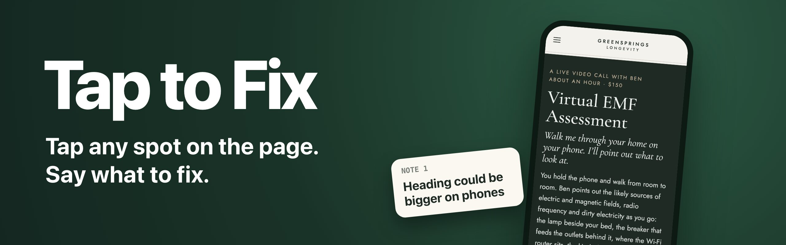
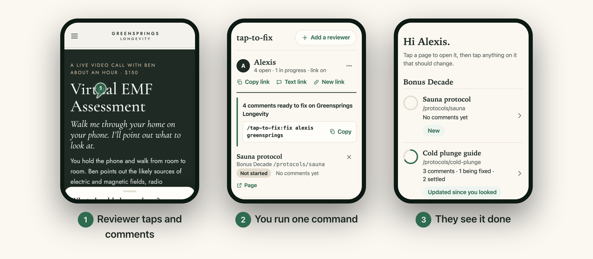

<p align="center">
  
</p>

<p align="center">
  
  <a href="CHANGELOG.md"></a>
  
  <a href="https://github.com/workingBen/tap-to-fix/actions/workflows/test.yml"></a>
</p>

<p align="center"><b>Your reviewers tap the live site on their phone and say what to fix.<br>Claude Code fixes each comment and tells them when it's done.</b></p>

<p align="center">
  
</p>

<p align="center"><a href="https://workingben.github.io/tap-to-fix/"><b>See the site</b></a> · <a href="#quickstart"><b>Install</b></a></p>

# tap-to-fix

tap-to-fix lets the people who review your website point at problems instead of describing them. A reviewer opens a private link on their phone, taps the spot that looks wrong, and types a comment. The comment lands in your own queue with a screenshot and the exact element they tapped. You then work through each reviewer's comments in Claude Code, and each comment's status goes back to the reviewer as you fix it. Reviewers need no account and nothing to install. Ordinary visitors to your site never see any of it.

It was built for [Greensprings Longevity](https://greensprings.life) and its Bonus Decade app, and it works with any site, whatever it is built with.

## How it works

1. **A reviewer taps.** You give each reviewer a private link. It opens their list of pages to review. On a page, they tap a spot, type what should change, and save.
2. **The comment is saved with a screenshot.** The browser takes a screenshot of what the reviewer sees, marks the tapped spot, and shrinks it before upload. The service stores the comment, the screenshot, the page, and enough about the element to find it again after the page changes.
3. **You see it on the owner dashboard.** It lists your reviewers, the pages assigned to each, and how many comments are waiting. For each reviewer with open comments it shows the command to run.
4. **Claude Code fixes them.** In your site's repo, run `/tap-to-fix:fix <reviewer> <site>`. It downloads that reviewer's comments and screenshots and runs them as a [proofs](https://github.com/workingBen/proofs) review cycle. Each comment is marked in progress when work on it starts, and done with its pull request link after merge.
5. **The reviewer sees the status.** Their list shows which pages have updates since they last looked.

## Quickstart

You need a free Cloudflare account, Claude Code, and Node (see **Requirements**).

1. **Install the plugins.** In Claude Code:

   ```
   /plugin marketplace add workingBen/proofs
   /plugin install proofs@proofs
   /plugin marketplace add workingBen/tap-to-fix
   /plugin install tap-to-fix@tap-to-fix
   ```

2. **Deploy your own service.** Run `/tap-to-fix:setup`. It signs you in to Cloudflare if needed, then creates one D1 database, one R2 bucket and one Worker on your account, and nothing else. It prints a script tag and your owner link. Save the owner link somewhere safe, such as a password manager.
3. **Add your site.** Open the owner link. Under **Sites**, add a site: a short slug, a name, its `https://` origin, and the GitHub repo that holds its code.
4. **Add the script tag** to every page of that site, before any analytics tag:

   ```html
   <script src="https://YOUR-SERVICE-ORIGIN/t.js" data-site="your-slug" defer></script>
   ```

   If your site has a content security policy, allow the service's origin in `script-src`, `connect-src` and `img-src`.
5. **Add a reviewer** on the owner dashboard and assign them some pages.
6. **Send them their link.** Use **Copy link** or **Text link** on that reviewer. They can add it to their phone's home screen.

When comments come in, run the command the dashboard shows, such as `/tap-to-fix:fix alexis bonus-decade`, from that site's repo.

## What is stored, and where

Everything lives in your own Cloudflare account. There is no shared or hosted service.

- **D1 database `tap-to-fix`:** sites, reviewers, assigned pages, and comments (text, status, the tapped element's location, the page, and the viewport size).
- **R2 bucket `tap-to-fix-shots`:** screenshots. They have no public URL. The service serves them only to the owner and to the reviewer who made them.
- **Reviewer tokens** are stored two ways. A SHA-256 hash is used to sign the reviewer in. A copy encrypted with AES-GCM, under a `LINK_KEY` Worker secret, lets the owner dashboard show the link again. Turning off a link deletes the encrypted copy.
- **The owner token** is never in the database. It is a Worker secret, and on your machine it is in `~/.config/tap-to-fix/config.json` (mode 0600). The owner dashboard keeps it in that browser's local storage after you open the owner link.

Each reviewer can save up to 20 comments a minute and 300 a day. A comment's text can be up to 5,000 characters, and its screenshot up to 1 MB. [SECURITY.md](SECURITY.md) lists every limit and how to report a vulnerability.

Reviewer links carry the token in the URL fragment (`#ttf=...`). Browsers never send the fragment to your site's server, its logs, or `Referer` headers. The script tag removes it from the address bar on load.

## Requirements

- Node 22.13 or newer (`service/.nvmrc` pins 22).
- A Cloudflare account. The free plan is enough for a handful of reviewers.
- Wrangler, the Cloudflare CLI. It is a dev dependency of `service/`, so `npm ci` installs it.
- Claude Code with the public [proofs](https://github.com/workingBen/proofs) plugin installed. `/tap-to-fix:fix` runs a proofs review cycle.

## Development

Run these from `service/`:

```bash
npm ci                    # install packages
npm test                  # unit and route tests (Vitest)
npm run typecheck         # TypeScript for the Worker, the browser client and the e2e harness
npm run e2e               # browser tests (Playwright: phone Chromium at 3x, Firefox desktop)
npm run dev:node          # dev server on http://localhost:8787 (needs OWNER_TOKEN in .dev.vars or the environment)
bash scripts/smoke.sh     # end-to-end check against the running dev server; ends with "smoke: ok"
```

Before the first `npm run e2e`, install the browsers once with `npx playwright install chromium firefox`. The harness starts the service on port 8788 and fixture sites on 4173 and 4174.

The service is a [Hono](https://hono.dev) app. Production runs it as a Cloudflare Worker. Local dev and tests run it on Node instead, with D1 backed by `node:sqlite` and R2 kept in memory, so they work on machines where `workerd` does not. The Node dev server keeps its database in `service/.local/dev.sqlite`. Its screenshots are lost on restart.

The repo holds:

- `service/`: the Worker (`src/`), the browser code (`client/`: the script tag, the comment layer and both dashboards), migrations, and tests.
- `bin/ttf.mjs`: the CLI the plugin's skills call.
- `skills/`: the Claude Code skills (`setup`, `list`, `fix`).
- `docs/superpowers/`: the design and the build plans.

## Deploying

`/tap-to-fix:setup` runs this for you. To run it by hand, from `service/`, after a one-time `npx wrangler login`:

```bash
npm run deploy
```

It creates (or reuses) only the D1 database `tap-to-fix` and the R2 bucket `tap-to-fix-shots`. It applies migrations, builds the client, sets the owner token as a Worker secret, deploys, and runs a read-only live check. It prints the script tag. It prints the owner link only when it made a new owner token. Run it again to redeploy: it reuses the resources and the saved token, and prints `Owner link: unchanged`. `--rotate-token` makes a new owner token and prints the new link. The first deploy also makes the `LINK_KEY` secret. It is kept in the same config file, never printed, and left alone by `--rotate-token`.

Two first-deploy snags:

- **No workers.dev name yet.** A new Cloudflare account has none, and the deploy stops with "You need to register a workers.dev subdomain". Pick one in the dashboard (Workers & Pages), or `PUT /accounts/<id>/workers/subdomain` with `{"subdomain":"NAME"}`. A new name takes about two minutes to start answering, so the first live check after it can fail with "fetch failed". Run the deploy again.
- **Safari sign-in fails** with "No CSRF value available in the session cookie". Run `wrangler login --browser=false` and open the printed link in another browser within about two minutes.

Scripts that call the Cloudflare API should send a normal user agent. Cloudflare answers Python's default `Python-urllib` with 403 "error code: 1010". `curl` and Node's `fetch` are fine.

## Claude Code plugin

```
/tap-to-fix:setup                      # deploy, and save the service URL and owner token
/tap-to-fix:list                       # every comment not settled yet, by reviewer, site and page
/tap-to-fix:fix                        # pick a batch from that list, then work it
/tap-to-fix:fix alexis bonus-decade    # one reviewer's open comments on one site, as a review cycle
```

`/tap-to-fix:list` runs `ttf open`. It prints every comment that is still open or in progress, grouped by reviewer, then site, then page, with each one's status, age and the start of its text. Each reviewer + site batch ends with the command that fixes it:

```
Alexis Rivera · Greensprings (greensprings) · 3 waiting
  /about
    in progress  2 days ago   Wrong color
    open         3 h ago      The heading is far too small on a phone and the line wraps …
  /
    open         5 min ago    Logo is blurry
  Run: /tap-to-fix:fix alexis greensprings

3 comments waiting in 1 batch.
```

When nothing is waiting, it says so. `/tap-to-fix:fix` with no arguments (or with only a reviewer, such as `/tap-to-fix:fix alexis`) shows the same list. Then it asks which batch to work, most comments first, and carries on with the one you pick. The CLI works on its own too: `node bin/ttf.mjs open [reviewer]`.

`/tap-to-fix:fix` downloads the batch (comments and screenshots) to `~/.tap-to-fix/batches/`. It marks each comment in progress as work on it starts, and done with its PR link after merge. `--resume` picks up an interrupted run. If the machine cannot reach the service, status updates wait in a local queue, and the owner dashboard offers the batch as a file to download.

## The script tag

The tag does nothing unless the visitor arrives with a reviewer link, so it is safe to ship on every page. Place it before any analytics tag, so the token is gone from the address bar before analytics reads it.

## How a reviewer link works

The owner creates a reviewer and assigns pages (a path on a site). The reviewer's link to a page carries the token in the fragment, `#ttf=TOKEN`. On load, `t.js` saves the token in `sessionStorage`, removes it from the address bar, and loads the comment layer (`overlay.js`). The reviewer taps a spot, types a comment and saves. The page's address, the element tapped and a screenshot go to the service. The bar's **Done** link (or **Back to your list**) opens the reviewer's list at `/r/#ttf=TOKEN`.

Without a token, nothing appears. On a page not assigned to the reviewer, the bar says "This page isn't on your review list", and every tap goes through to the page as usual. On sites that swap pages without a full reload (Turbo Drive, other routers), the comment layer follows along on `turbo:load`, `popstate` and `pageshow`.

## Dashboards

**Owner (`/o/`).** Open `https://YOUR-SERVICE-ORIGIN/o/#owner=OWNER_TOKEN` once. The page saves the token in `localStorage`, removes it from the address bar, and shows your reviewers, pages and sites. On a later visit, `/o/` alone works from the same browser. If the token is missing or wrong, the page asks you to paste it. From there you add sites, reviewers and assigned pages, and copy each "ready for a review cycle" command (`/tap-to-fix:fix <first name> <site slug>`). Each reviewer has **Copy link**, **Text link** (opens a new text message with the link in it), **New link** and **Turn off link**. The link is fetched only when you tap, and only the owner can fetch it. Reviewers added before links were kept show a note asking for **New link** once.

**Reviewer (`/r/`).** The reviewer's link is `https://YOUR-SERVICE-ORIGIN/r/#ttf=THEIR_TOKEN`. It opens their list of pages with status chips. Tapping a page opens the live site with the comment layer on. The token stays in the address bar so the page can be added to a phone's home screen. **New link** makes the old one stop working.

## License

[MIT](LICENSE)
